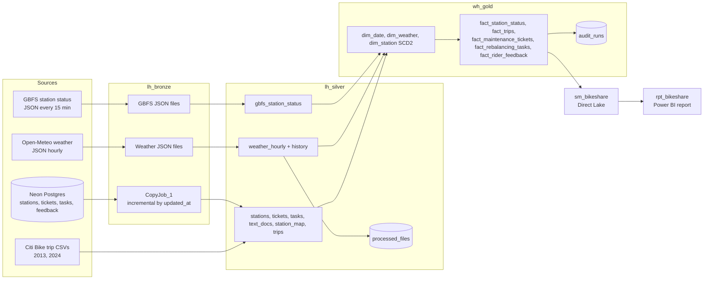

# Architecture

## Pipelines
- **pl_ingest_gbfs** (15 min), **pl_ingest_weather** (hourly): Bronze
- **pl_refresh_master** (hourly): nb_refresh_gbfs, nb_refresh_weather, Gold daily refresh, audit checks
- **pl_sync_operations** (manual, after simulators): CopyJob_1, nb_refresh_station_mapping, Gold ops refresh, ops audit
- **nb_maintenance_delta** (weekly, manual): OPTIMIZE and VACUUM